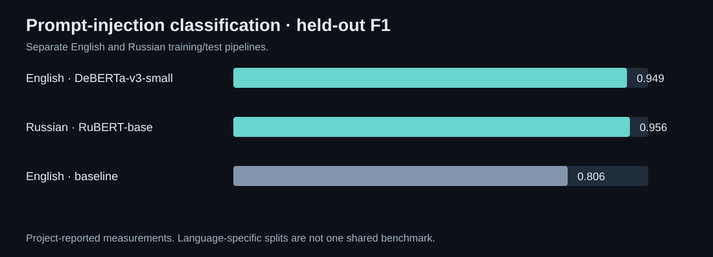
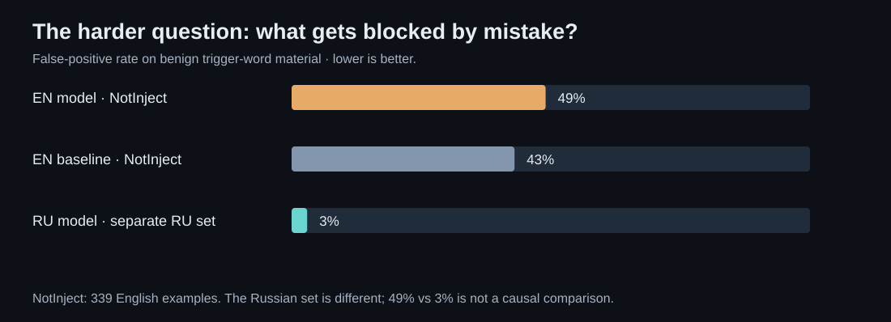

# Prompt Injection Detection
### Detect an instruction attack without blocking every discussion of one.

A bilingual ML investigation for English and Russian text, with a documented follow-on detection API. The project studies both attack classification and a failure mode that aggregate accuracy can hide: benign text containing words that resemble an attack.

*Charts reconstructed from the project’s documented test results. English and Russian use separate language-specific evaluation splits.*

[Run and develop](#run-and-develop) · [Technical documentation](DEVELOPMENT.md)

## The dataset is part of the model

The preparation pipeline assembled approximately **46,600 rows**: about **17,900 English** and **28,800 Russian** examples. Normalization, exact deduplication and MinHash/LSH near-duplicate handling reduce repeated material before training. The documented split is stratified 80/10/10, with class balancing performed as part of preparation.

Near-duplicates matter because a random split can otherwise reward memorizing a template that appears in both training and test data. The project therefore treats preparation as an explicit engineering stage rather than reporting a classifier score without describing its inputs.

## Two language-specific classifiers

The English model uses **DeBERTa-v3-small**; the Russian model uses **RuBERT-base**. Separate language handling keeps the data and evaluation assumptions visible. The experiments compare the trained models with an English ProtectAI baseline.

| Evaluation | Accuracy | F1 |
|---|---:|---:|
| English model | 0.969 | 0.949 |
| Russian model | 0.974 | 0.956 |
| English baseline | 0.866 | 0.806 |

Those are the project-reported held-out measurements. They are useful within the documented experiment, but do not establish robust protection against every new prompt-injection strategy.

## False positives change the story

A security filter can achieve an attractive F1 while incorrectly blocking legitimate analysis, quoted attack examples or policy discussion. The project therefore tested benign trigger-word material separately.

*The English model still blocked 49% of the 339-example NotInject set. The separate Russian set is not directly comparable.*

The English result is an important limitation, not a footnote to hide. The Russian model’s 3% result comes from different material; it cannot establish that one language or training method solved the English failure mode. A deployment needs to choose thresholds and measure false positives against its own intended traffic.

## Follow-on work: the detection API

The separately developed Stage 2 prototype exposes a FastAPI service with a detection endpoint, health reporting and supported-language information. Requests can specify English, Russian or automatic language selection. Responses include the classification score, attack-type information and word-span output.

~~~mermaid
flowchart LR
 A[Input text and language choice] --> B[Language routing]
 B --> C[Model inference]
 C --> D[Score and classification]
 D --> E[Attack-type / span response]
 F[Health: real model or stub] --> C
~~~

**Published code scope:** this repository contains the Stage 1 training notebook and specification. The Stage 2 API described here is follow-on project work and is not included in this checkout.

The API prototype includes key-based access and rate limiting. Health distinguishes real model loading from stub operation so an integration cannot mistake a lightweight test backend for a deployed classifier. Model weights and the training corpus are not distributed in this showcase.

## What the work contributes as an artifact

The project connects dataset preparation, model training, a difficult benign evaluation and a usable API boundary. It is not a screenshot-driven dashboard project, so the visuals here are measured charts and a service diagram rather than invented application screens.

**Technology:** Python, transformer classifiers, PyTorch / Hugging Face tooling, MinHash/LSH deduplication and FastAPI. The main unresolved issue is operating-point quality: the English benign challenge demonstrates that a high aggregate score alone is insufficient for a reliable blocking policy.

## Run and develop

### Explore the published experiment

Start with [the Stage 1 notebook](notebooks/variant_e_stage1.ipynb) and [reproduction notes](DEVELOPMENT.md#reproduce-in-google-colab). Training downloads the documented source datasets; GPU availability and provider access affect reproduction. Saved model weights and the consolidated corpus are managed separately.

[Development guide](DEVELOPMENT.md) · [Preserved presentation materials](docs/showcase/README.md)

---

### Built by

[Shakhnazar Akhmer](https://github.com/Eye172).

[More projects](https://github.com/Eye172) · [Contact](mailto:shakh090909@gmail.com)

This repository presents the product and its engineering. The Stage 1 implementation is published here. Model weights, the consolidated corpus and the follow-on API are maintained separately. Screenshots and documented experiments are identified in their captions.

---

Account history: Magitcian172 → Eye172 (same developer). [Authorship note](AUTHORSHIP.md).
